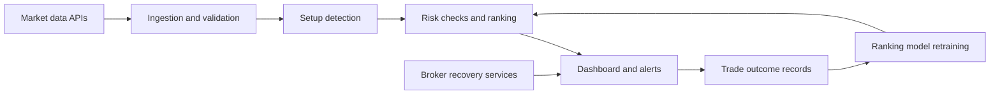

# Futures Analytics Platform

A TypeScript and Node.js portfolio project for processing live futures data, evaluating trade setups, and presenting alerts and operational status to a human operator. The engineering focus is API integration, application reliability, automated testing, and observable backend workflows.

## At a glance

- Backend: TypeScript, Node.js, Fastify, and Zod validation.
- Data flow: market-data ingestion, setup detection, risk checks, and ranking.
- Reliability: broker reconnect handling, persisted recovery state, data-quality checks, and alerts.
- Interface: a mobile web dashboard with session summaries and alert review.
- Delivery: Vitest tests, GitHub Actions, and Linux/VPS deployment configuration.
- Persistence: local JSON and NDJSON files; this application does not require PostgreSQL.

## How it works



The application combines deterministic risk rules with a learned ranking layer. Alerts support operator review; they are not a promise of investment returns. See [architecture and tradeoffs](docs/ARCHITECTURE.md) for more detail.

## Code worth reviewing

| Engineering area | Implementation | Test example |
| --- | --- | --- |
| HTTP application | [Fastify application](Trading_Algorithm_v1/src/app.ts) | [Execution lifecycle](Trading_Algorithm_v1/tests/integration/executionLifecycle.test.ts) |
| Risk controls | [Risk engine](Trading_Algorithm_v1/src/services/riskEngine.ts) | [Guardrail acceptance tests](Trading_Algorithm_v1/tests/acceptance/guardrails.test.ts) |
| Ranking | [Ranker](Trading_Algorithm_v1/src/services/ranker.ts) | [Ranker unit tests](Trading_Algorithm_v1/tests/unit/ranker.test.ts) |
| Model retraining | [Continuous training service](Trading_Algorithm_v1/src/training/continuousTrainingService.ts) | [Training integration tests](Trading_Algorithm_v1/tests/integration/continuousTraining.test.ts) |
| Recovery persistence | [Reconnect state store](Trading_Algorithm_v1/src/stores/ibkrReconnectStateStore.ts) | [Recovery persistence tests](Trading_Algorithm_v1/tests/integration/ibkrReconnectStatePersistence.test.ts) |

The [mobile dashboard](Trading_Algorithm_v1/public/mobile/index.html) shows the operator-facing side of the system.

## Local setup

Install Node.js compatible with the project dependencies, then run:

```sh
cd Trading_Algorithm_v1
npm ci
npm run build
npm test
```

Review the application configuration and provider credentials before starting development services with `npm run dev`. External market-data, broker, and notification integrations require separate configuration. Keep credentials outside source control.

## Scope and limitations

This is an independent portfolio project rather than a commercial trading product. Model quality depends on the available data and evaluation method; successful software tests do not establish trading profitability. File-backed persistence suits the current deployment design but has concurrency and scaling limits that a shared database would address.

Changes to the main branch can trigger the configured VPS deployment workflow. Review deployment settings before using the workflow in another environment.
